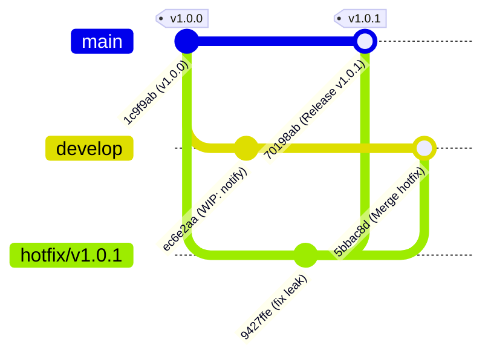

# Báo Cáo Bài Tập 4: Mô Phỏng Quy Trình Hotfix & Gitflow Thực Tế

- **Môn học:** IT209 - Quản lý Cấu hình và Phiên bản (SCM)
- **Bài tập:** Session 05 - Bài 4 (ex4)
- **Đường dẫn nộp bài dự kiến trên GitHub:** `homework/session_05/ex4/`

---

## 1. Mục Tiêu Bài Thực Hành
- Áp dụng mô hình phân nhánh **Gitflow chuẩn** trong quản lý vòng đời phát triển phần mềm (Software Development Life Cycle - SDLC).
- Thực hành tạo, sửa lỗi khẩn cấp và tích hợp nhánh **Hotfix** trực tiếp vào hệ thống production đang vận hành.
- Thực hiện cơ chế **đồng bộ hóa ngược bản vá nóng (back-merge hotfix)** về nhánh phát triển (`develop`) nhằm loại bỏ triệt để nguy cơ trôi lỗi (bug regression) ở các phiên bản kế tiếp.

---

## 2. Bối Cảnh & Kịch Bản Giả Lập

### 2.1. Hiện trạng hệ thống
- **Nhánh `main`:** Đại diện cho môi trường Production ổn định, hiện đang ở phiên bản phát hành **`v1.0.0`** (commit `1c9f9ab`).
- **Sự cố khẩn cấp (Critical Bug):** Bộ phận bảo mật phát hiện lỗ hổng nghiêm trọng trong hàm `get_user_profile` tại file `app.py`. API đang trả về cả các trường nhạy cảm bao gồm mã băm mật khẩu (`password_hash`) và khóa bí mật (`api_secret_key`), đe dọa an toàn dữ liệu người dùng.
- **Nhánh `develop`:** Đội ngũ phát triển đang tích cực triển khai các tính năng mới dở dang cho phiên bản tiếp theo `v1.1.0` (commit `ec6e2aa`: thêm module thông báo `notifications.py` chưa hoàn tất). 

### 2.2. Thách thức kỹ thuật đặt ra
- **Không thể deploy từ `develop`:** Vì nhánh `develop` chứa mã nguồn WIP (Work In Progress) chưa được kiểm thử toàn diện, nếu đưa `develop` lên production sẽ gây vỡ hệ thống.
- **Không thể trì hoãn sửa lỗi:** Lỗi rò rỉ dữ liệu cần phải được vá và phát hành ngay lập tức (zero-day vulnerability).
- **Yêu cầu Gitflow:**
  1. Tách nhánh sửa lỗi khẩn cấp `hotfix/v1.0.1` trực tiếp từ nhánh `main` tại tag `v1.0.0`.
  2. Khắc phục lỗi và gộp bản vá này vào `main`, đồng thời gắn tag phiên bản `v1.0.1` để release ngay cho production.
  3. Bắt buộc phải gộp bản vá `hotfix/v1.0.1` ngược lại vào nhánh `develop` để mã nguồn tương lai cũng sở hữu bản sửa lỗi này.

---

## 3. Các Bước Triển Khai Chi Tiết Theo Gitflow

### Bước 1: Tách nhánh khẩn cấp `hotfix/v1.0.1` từ nhánh `main`
Từ nhánh `main` (phiên bản `v1.0.0`), tạo và chuyển ngay sang nhánh hotfix:
```bash
git checkout main
git checkout -b hotfix/v1.0.1
```

### Bước 2: Thực hiện sửa lỗi bảo mật trên nhánh Hotfix
Chỉnh sửa file `app.py`, loại bỏ hoàn toàn các trường dữ liệu nhạy cảm:
```python
# app.py (sau khi chỉnh sửa trên hotfix/v1.0.1)
# User Management Service - Version 1.0.1 (Hotfix)

def get_user_profile(user_id, database):
    user = database.get(user_id)
    if not user:
        return None
    # HOTFIX v1.0.1: Removed sensitive credentials leak (password_hash, api_secret_key)
    return {
        "id": user["id"],
        "name": user["name"],
        "email": user["email"]
    }
```

Lưu thay đổi và tạo commit sửa lỗi:
```bash
git add app.py
git commit -m "fix(security): resolve user credential leak vulnerability"
```
*(Commit hash tạo ra: `9427ffe`)*

### Bước 3: Gộp Hotfix vào `main` và đánh tag phát hành `v1.0.1`
Chuyển về nhánh `main`, thực hiện gộp nhánh với cờ `--no-ff` (non-fast-forward) để lưu vết lịch sử nhánh hotfix, sau đó tạo Annotated Tag `v1.0.1`:
```bash
git checkout main
git merge --no-ff hotfix/v1.0.1 -m "Merge branch 'hotfix/v1.0.1' into main"
git tag -a v1.0.1 -m "Release v1.0.1 - Hotfix user data leak"
```
*(Commit hash merge trên main: `70198ab` trỏ tới tag `v1.0.1`)*

### Bước 4: Đồng bộ hóa bản vá ngược về nhánh `develop`
Chuyển sang nhánh `develop` và gộp nhánh hotfix vào nhằm đảm bảo phiên bản `v1.1.0` tương lai không bị tái diễn lỗi này:
```bash
git checkout develop
git merge --no-ff hotfix/v1.0.1 -m "Merge branch 'hotfix/v1.0.1' into develop"
```
*(Commit hash merge trên develop: `5bbac8d`)*

### Bước 5: Dọn dẹp nhánh cục bộ (Clean-up)
Sau khi bản vá đã được tích hợp đầy đủ vào cả hai nhánh huyết mạch (`main` và `develop`), nhánh hotfix hoàn thành sứ mệnh và có thể dọn dẹp an toàn:
```bash
# Xóa nhánh hotfix cục bộ sau khi đã hoàn tất gộp
git branch -d hotfix/v1.0.1
```

---

## 4. Sơ Đồ Phân Nhánh & Gộp Nhánh Gitflow

### 4.1. Sơ đồ trực quan bằng ASCII Art

```text
       (v1.0.0)                                    (v1.0.1 - Release)
main:     o ----------------------------------------------- o [70198ab]
           \                                               /
            \                      [hotfix/v1.0.1]        /
hotfix:      \                           o --------------+  [9427ffe: fix security leak]
              \                         /               \
               \                       /                 \
develop:        o ------------------- o ------------------ o [5bbac8d]
             [1c9f9ab]             [ec6e2aa]
            (Init release)       (WIP: notifications)
```

**Mô tả luồng đi của mã nguồn:**
1. Tại điểm xuất phát `1c9f9ab`, nhánh `develop` rẽ nhánh để làm tính năng mới (`ec6e2aa`).
2. Phát hiện lỗi nghiêm trọng trên `main`, lập tức rẽ nhánh `hotfix/v1.0.1` từ `1c9f9ab`.
3. Commit `9427ffe` hoàn thành việc vá lỗ hổng rò rỉ thông tin cá nhân.
4. Nhánh hotfix được gộp vào `main` tại `70198ab`, gắn nhãn phiên bản `v1.0.1`.
5. Nhánh hotfix được gộp ngược vào `develop` tại `5bbac8d` (đồng bộ tính năng bảo mật với mã nguồn phát triển dở dang).

### 4.2. Sơ đồ Gitflow bằng Mermaid GitGraph



### 4.3. Đồ thị commit thực tế trích xuất từ Repository

```text
*   5bbac8d (develop) Merge branch 'hotfix/v1.0.1' into develop
|\  
* | ec6e2aa feat(develop): WIP add notification module for v1.1.0
| | * 70198ab (HEAD -> main, tag: v1.0.1) Merge branch 'hotfix/v1.0.1' into main
| |/| 
|/|/  
| * 9427ffe (hotfix/v1.0.1) fix(security): resolve user credential leak vulnerability
|/  
* 1c9f9ab (tag: v1.0.0) feat: initial release v1.0.0
```

---

## 5. Kiểm Tra & Đánh Giá Kết Quả (Verification)

### 5.1. Kiểm tra danh sách nhánh (`git branch -a`)
```bash
$ git branch -a
  develop
  hotfix/v1.0.1
* main
```
> Nhánh `main` đang là nhánh active. Cả hai nhánh `main` và `develop` đều đã nhận bản vá. Nhánh `hotfix/v1.0.1` đã hoàn tất nhiệm vụ.

### 5.2. Kiểm tra danh sách tag và chi tiết phiên bản (`git tag -n`)
```bash
$ git tag -n
v1.0.0          Release version 1.0.0
v1.0.1          Release v1.0.1 - Hotfix user data leak
```

Chi tiết Annotated Tag `v1.0.1`:
```bash
$ git show v1.0.1
tag v1.0.1
Tagger: Quang Nguyen <nguyendangquang0510@example.com>
Date:   Sat Oct 3 21:20:11 2026 +0700

Release v1.0.1 - Hotfix user data leak

commit 70198ab65cee0ead1f1c9f437447baa35c90a990
Merge: 1c9f9ab 9427ffe
Author: Quang Nguyen <nguyendangquang0510@example.com>
Date:   Sat Oct 3 21:20:11 2026 +0700

    Merge branch 'hotfix/v1.0.1' into main
```

### 5.3. Kiểm tra tính toàn vẹn mã nguồn sau khi vá
- **Trên nhánh `main`:**
  File `app.py` đã loại bỏ hoàn toàn `password_hash` và `api_secret_key`, bảo vệ dữ liệu người dùng trên môi trường production.
- **Trên nhánh `develop`:**
  File `app.py` đã đồng bộ logic bảo mật an toàn, đồng thời file `notifications.py` (tính năng mới đang phát triển) vẫn được giữ nguyên vẹn mà không bị ảnh hưởng.

---

## 6. Tổng Kết & Bài Học Rút Ra Về Gitflow

1. **Nguyên tắc cô lập nhánh khẩn cấp:** Khi xảy ra sự cố trên production, không bao giờ sửa trực tiếp trên `main` hoặc `develop`. Việc tách nhánh `hotfix/*` từ `main` giúp tập trung giải quyết đúng phạm vi lỗi mà không bị lẫn mã nguồn thử nghiệm hoặc chưa ổn định từ các nhánh khác.
2. **Quy tắc bắt buộc "Hai ngả gộp" (Dual-merge):** 
   - Mọi nhánh Hotfix sau khi hoàn tất **bắt buộc phải gộp vào cả `main` và `develop`**.
   - Nếu quên gộp về `develop`, khi phiên bản tiếp theo (`v1.1.0`) từ `develop` được merge vào `main` trong tương lai, lỗi rò rỉ dữ liệu cũ sẽ bị tái phát (Regression Bug) do mã nguồn `develop` bị trôi lỗi.
3. **Ý nghĩa của việc sử dụng `--no-ff` (No Fast-Forward):** 
   - Giúp Git luôn tạo một merge commit ghi lại điểm hội tụ của nhánh. Điều này giúp các lập trình viên và công cụ CI/CD dễ dàng truy vết lại lịch sử phát hành của từng bản hotfix trong quá khứ.
4. **Vòng đời của nhánh Hotfix:** Nhánh hotfix là nhánh ngắn hạn (temporary/ephemeral branch). Ngay khi đã merge thành công vào cả `main` và `develop` và đánh tag, nhánh này có thể xóa bỏ (`git branch -d`) để giữ cây repository luôn tinh gọn.
